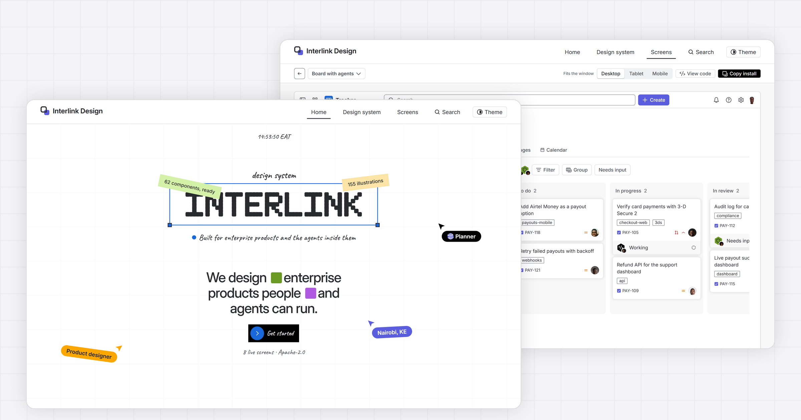
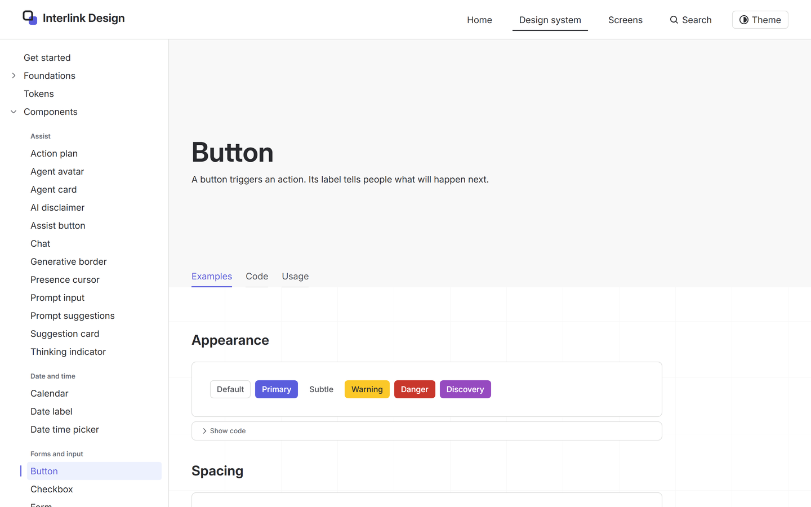
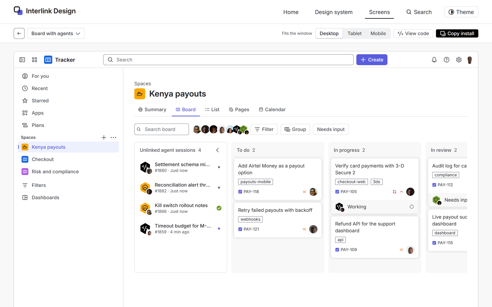
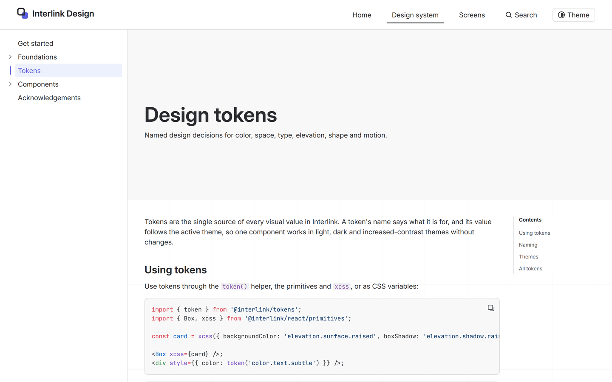
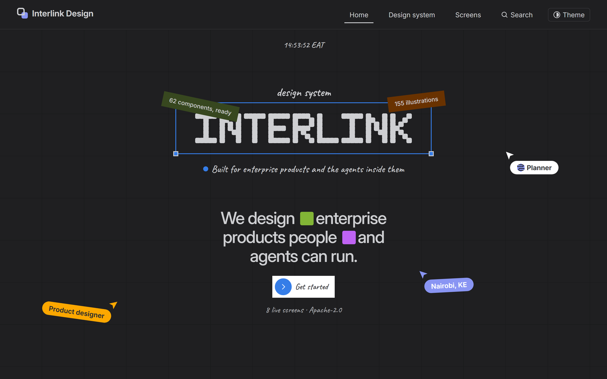

<p align="center">
  
</p>

<h1 align="center">Interlink Design</h1>

<p align="center">
  An enterprise design system for teams that ship with AI.<br />
  <a href="https://interlink.denisivalence.tech"><strong>interlink.denisivalence.tech</strong></a>
</p>

<p align="center">
  
  
  
</p>

## What's inside

| | |
|---|---|
| **62 components** | From buttons to agent chat, each with examples, props, keyboard support and tests. |
| **642 design tokens** | Colour, type, space, shadow and motion for light, dark and high contrast. |
| **155 illustrations** | Recolourable art for empty states, onboarding, finance, commerce and more. |
| **102 Do and Don't rules** | Every rule ships as live code, so a person, a linter and an agent read the same rule. |
| **8 full screens** | Real dashboards you can open, read and install. |

## A look around

<table>
  <tr>
    <td width="50%"></td>
    <td width="50%"></td>
  </tr>
  <tr>
    <td width="50%"></td>
    <td width="50%"></td>
  </tr>
</table>

## Packages

| Package | What it is |
|---|---|
| `@interlink/tokens` | Design tokens: CSS variables, `token()`, theme helpers and token metadata |
| `@interlink/css` | Base stylesheet: cascade layers, tokens, fonts and reset |
| `@interlink/react` | Primitives and components for React, one entry point per component |
| `@interlink/icons` | 16px glyphs drawn in `currentColor`, with search metadata |
| `@interlink/illustrations` | Spot and hero illustrations that products can recolour |

## Quick start

```tsx
import '@interlink/css/interlink.css';
import '@interlink/react/styles.css';
import { Button } from '@interlink/react/button';
import { TourNote } from '@interlink/react/tour-note';

export function Toolbar() {
  return (
    <TourNote placement="right" content="Publish when the page is ready.">
      <Button appearance="primary">Publish</Button>
    </TourNote>
  );
}
```

Themes are one attribute: set `data-color-mode="light"` or `"dark"` on `<html>`.

## Develop

```sh
pnpm install
pnpm build      # tokens, css, icons, illustrations, react, then the docs
pnpm test
pnpm dev        # docs site on http://localhost:3110
```

The docs site lives in `apps/docs` and builds to a static export. See `AGENTS.md` for the rules of the repo.

## Licence

Apache-2.0. See `LICENSE` and `NOTICE`. Photos are credited in `apps/docs/public/photos/CREDITS.md`.

<p align="center"><sub>Made by <a href="https://github.com/isonlycoolie">isonlycoolie</a></sub></p>
